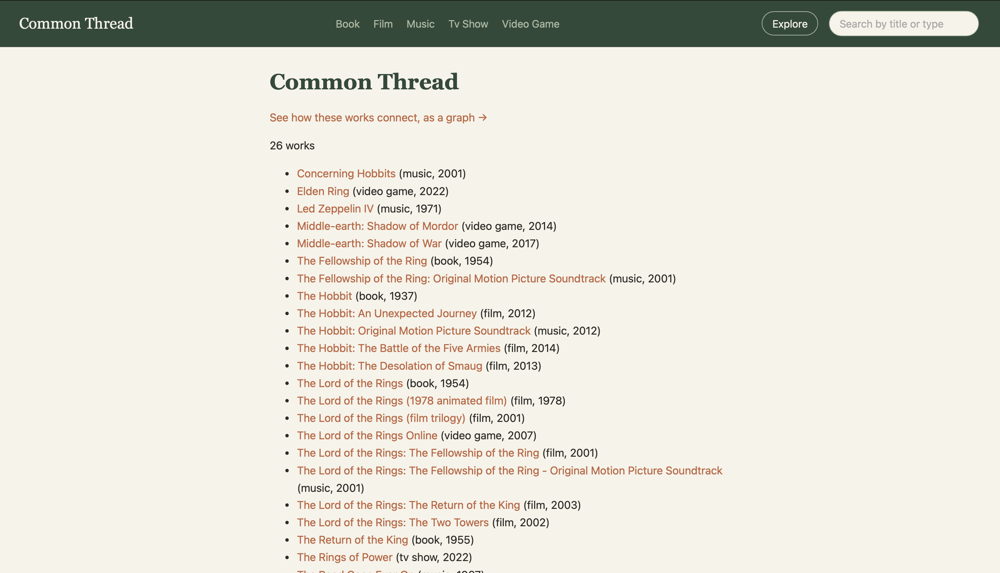
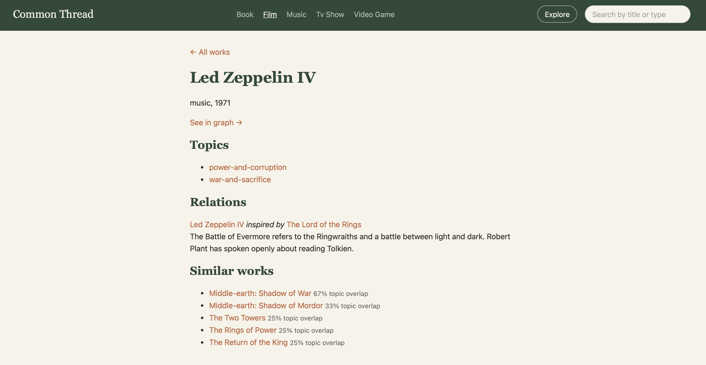
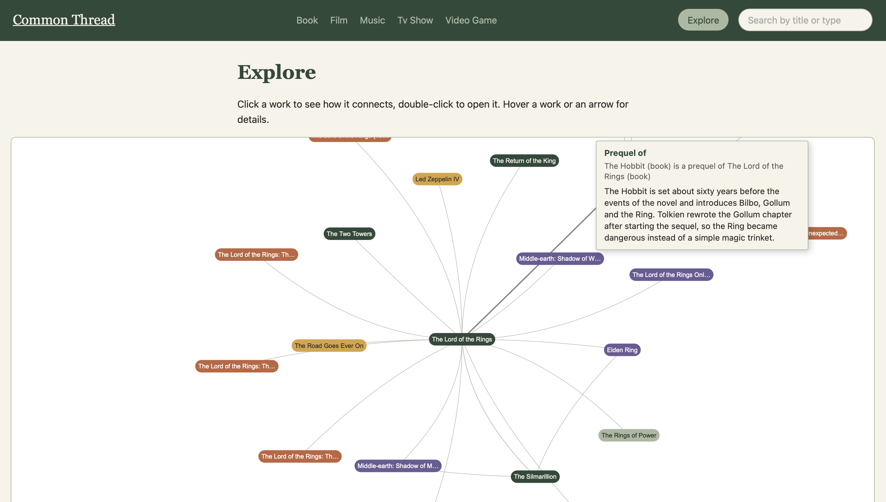

# common_thread# Common Thread

A small web app that connects books, films, TV shows, video games and music through shared **themes** and **explained relations**. Instead of just listing that one work "is related to" another, every connection says *how*: what it adapts, what it prequels, which themes the two share.

The current dataset is hand-curated and built around Tolkien's Middle-earth (26 works), as a first universe to prove the model.



## Features

- **Browse and search** works by type (book, film, TV show, video game, music) or by title.
- **Work pages** with themes, directional relations (each with a written explanation) and **similar works**.
- **Topic pages** listing every work that shares a theme.
- **Interactive relationship graph**: works are colored nodes, relations are arrows. Hover for the explanation, click to highlight a work's connections, double-click to open it.
- **Similarity** based on the Jaccard index over shared themes.
- **One-command database rebuild** from a single JSON file.





## Tech stack

- Python 3.12, **Flask**, Jinja templates
- **SQLite** through the standard `sqlite3` module (plain SQL, no ORM)
- **vis-network** for the graph (loaded from a CDN, so the graph page needs an internet connection)
- **pytest** for tests

## Getting started

```bash
git clone https://github.com/mrossato00/common_thread.git
cd common_thread

python3 -m venv .venv
source .venv/bin/activate
pip install -r requirements.txt

python scripts/build_db.py
flask --app app run --debug --port 5001
```

Then open http://127.0.0.1:5001.

Port 5001 is used because on macOS port 5000 is often taken by AirPlay.

## Data

All content lives in `data/seed.json`, in three sections: `works`, `topics` and `relations`. The SQLite file is generated, not committed: running `python scripts/build_db.py` deletes the old database and rebuilds it from `db/schema.sql` and the JSON.

### Data model

| Table | Purpose |
|---|---|
| `works` | A book, film, TV show, video game or album |
| `topics` | Themes such as "power-and-corruption" |
| `creators` | Authors, directors, composers |
| `work_topics`, `work_creators` | Many-to-many link tables |
| `relations` | A directed, typed connection between two works, with an explanation |

Useful example queries are kept in `db/queries.sql`.

## Project structure

```
app.py               Flask routes and JSON endpoint for the graph
similarity.py        Jaccard similarity between works
db/schema.sql        Database schema
db/queries.sql       Example queries
scripts/build_db.py  Builds the database from data/seed.json
data/seed.json       The dataset
templates/           Jinja templates (shared base layout)
static/style.css     Styles
tests/               pytest tests
```

## Tests

```bash
python -m pytest -v
```

The suite covers the main pages, search, 404 handling, the graph API and the similarity function.

## Limitations and next steps

- The dataset is small and centered on one universe, so similarity scores are high for most works. Adding works from other worlds is the next step.
- Theme tagging is manual; a consistent number of themes per work would improve similarity results.
- Possible extensions: characters and places, and a feature that turns a relation into a short narrative from the stored facts.